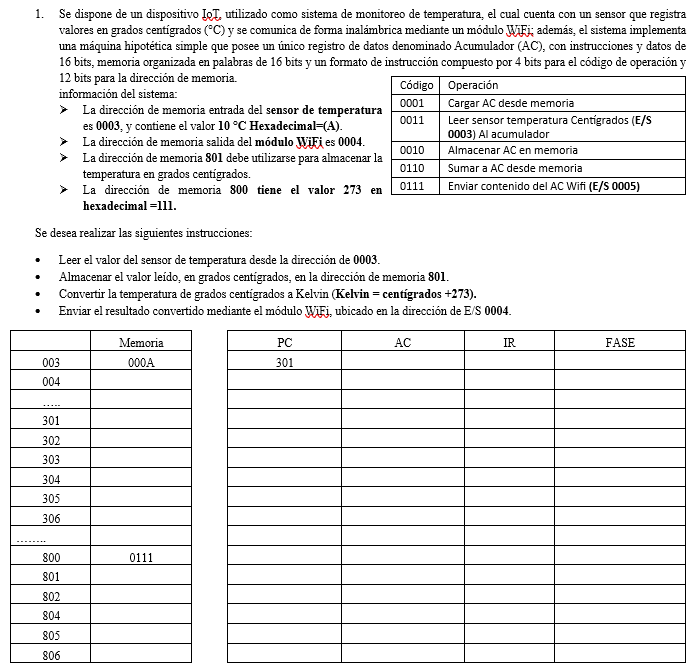
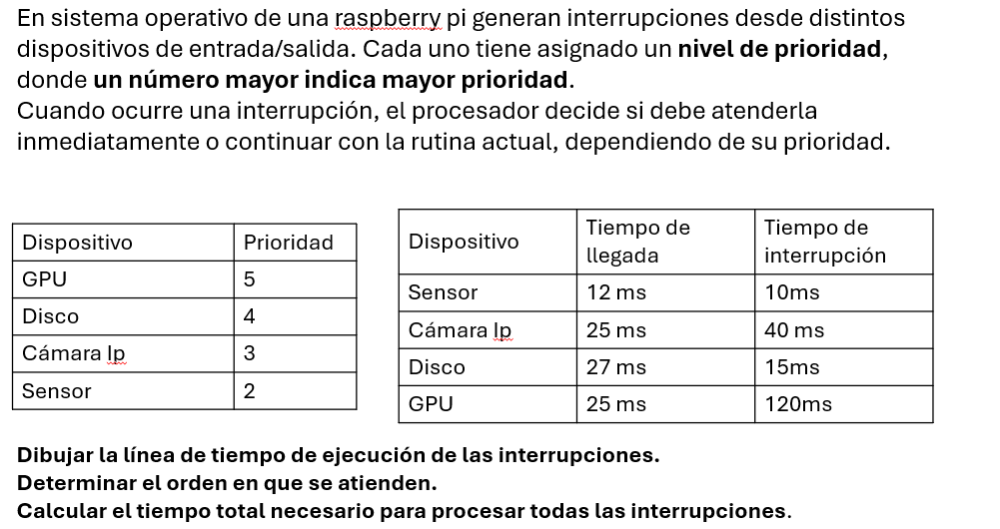

## 📋 Enunciado
### 🧮 Ejercicio 1
Resolver el ejercicio de la máquina hipotética, completando las tablas de memoria y el seguimiento de la ejecución de instrucciones.
{width=100%}
### ⚡ Ejercicio 2

Resolver el ejercicio de gestión de interrupciones en una Raspberry Pi. Dibujar la línea de tiempo de ejecución, determinar el orden de atención de las interrupciones y calcular el tiempo total de procesamiento.

{width=100%}
## 📄 Solución en PDF

[📥 Descargar PDF](../archivos/deber001J_Cusquillo.pdf){.btn-descarga}

<iframe class="visor-pdf" src="../archivos/deber001J_Cusquillo.pdf"></iframe>